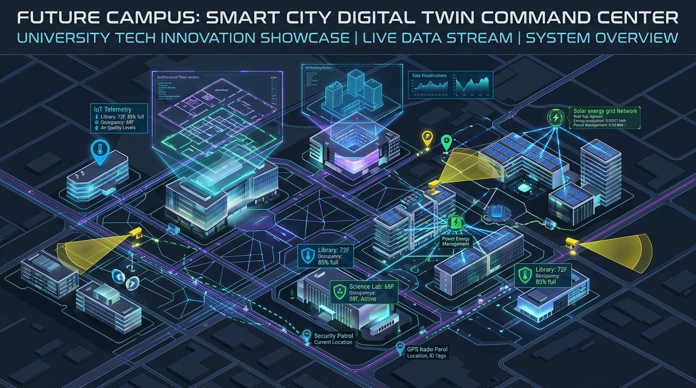
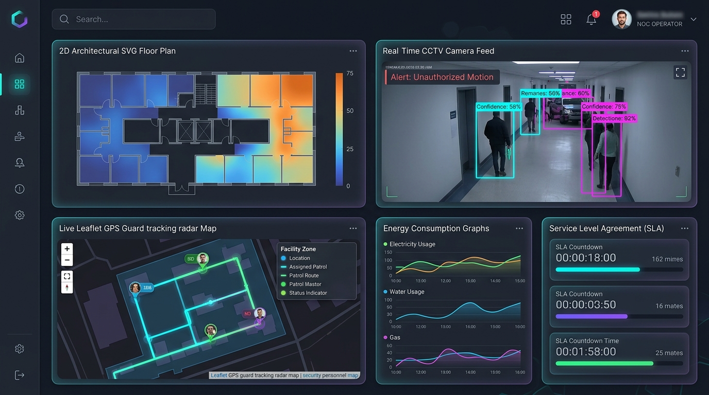

<div align="center">

# 🏢 Smart Campus Digital Twin & Facility Intelligence

[](LICENSE)
[](https://fastapi.tiangolo.com/)
[](https://react.dev/)
[](https://vitejs.dev/)
[](https://tailwindcss.com/)
[](https://www.mongodb.com/)
[](https://docs.ultralytics.com/)
[](https://ai.google.dev/)

**Next-Gen Autonomous Campus Command Center • 2D Spatial Digital Twin • Real-Time CCTV • GPS Guard Radar • SLA Autopilot**

<br />



</div>

---

## ⚡ At a Glance

The **Smart Campus Digital Twin & Facility Intelligence Platform** unifies physical facilities, surveillance, and personnel management into a centralized cyber-physical command center.

<br />

<div align="center">
  
</div>

<br />

### Core Modules

| Module | Engine | Key Capabilities |
| :--- | :--- | :--- |
| 🗺️ **2D Spatial Digital Twin** | Custom SVG Blueprint Engine | Multi-floor block maps, live occupancy badges, per-room kW power telemetry, room health scores. |
| 📹 **CCTV & RTSP Wall** | Multi-Stream Video Matrix | Live RTSP/HLS feeds, AI bounding boxes, incident snapshots, and forensic audit logging. |
| 🤖 **Autonomous AI Sentinel** | YOLOv8 + Gemini 1.5 Flash | 15s vision loop detecting overcrowding, smoke/fire hazards, and physical altercations. |
| 📡 **GPS Guard Radar** | Leaflet + Haversine Matcher | Sub-second guard telemetry, proximity-based emergency dispatch, and interactive patrol route simulation. |
| ⚡ **Facility & Ghost Energy** | SLA Scheduler + Motor DB | Identifies power leakage in vacant rooms (>10m), tracks tariff costs (₹/kWh), and executes 3-tier SLA escalations. |
| 💬 **CampusGPT RAG** | Vector Embeddings & LLM | Semantic knowledge assistant answering student & staff queries over official campus policies. |

---

## 👥 Role Portals & Demo Logins

The database is pre-seeded with 6 role-based profiles (`backend/app/seed.py`):

| Role | Portal URL | Mode | Username / Staff ID | Password / PIN |
| :--- | :--- | :--- | :--- | :--- |
| **Super Admin** | `/admin` | Official | `admin@campus.edu` | `Admin@123` |
| **Security Head** | `/security-head` | Official | `security.head@campus.edu` | `SecHead@123` |
| **Security Guard** | `/guard-app` | PIN | `SEC-101` / `SEC-104` | `1111` |
| **Facility Supervisor** | `/facility-head` | Official | `facility.head@campus.edu` | `FacHead@123` |
| **Ground Worker** | `/worker-app` | PIN | `FAC-201` / `FAC-202` | `1111` |
| **Student / Faculty** | `/campus-portal` | Official | `rahul@campus.edu` | `Student@123` |

---

## 🚀 Quick Start

### 1. One-Click Launch

**Windows (PowerShell):**
```powershell
.\start_platform.ps1
```

**Linux / macOS / WSL (Bash):**
```bash
chmod +x ./start_platform.sh
./start_platform.sh
```

- **Frontend App:** http://localhost:5173
- **FastAPI API & Docs:** http://localhost:8000/docs

---

### 2. Manual Step-by-Step

<details>
<summary><b>Click to expand manual setup instructions</b></summary>

#### Backend Setup
```bash
cd backend
cp .env.example .env
pip install -r requirements.txt
# Optional: Seed initial database
python -c "import asyncio; from app.seed import seed_initial_data; asyncio.run(seed_initial_data())"
# Run backend
python -m uvicorn app.main:app --host 0.0.0.0 --port 8000 --reload
```

#### Frontend Setup
```bash
cd frontend
cp .env.example .env
npm install
npm run dev
```

#### Production Build
```bash
cd frontend
npm run build
npm run start
```
</details>

---

## 🛠️ Architecture & System Design

<details>
<summary><b>Click to expand System Architecture Diagram</b></summary>

```text
┌────────────────────────────────────────────────────────────────────────┐
│                        PHYSICAL CAMPUS LAYER                           │
│   [CCTV / RTSP]    [Power Meters]    [GPS Guard Beacons]    [SOS]      │
└───────────────────────────────────┬────────────────────────────────────┘
                                    │ WebSocket Heartbeats & Telemetry
                                    ▼
┌────────────────────────────────────────────────────────────────────────┐
│                        FASTAPI GATEWAY (:8000)                         │
│  • REST Routers (Auth, Admin, Security, Guard, Facility, Worker, RAG)  │
│  • WebSocket Gateway: /ws/{role}/{userId}                              │
│  • Background Schedulers: 10s SLA Engine & 15s AI Vision Sentinel      │
│  • Services: YOLOv8, OpenCV, Google Gemini, Haversine GPS Matcher      │
└───────────────────────────────────┬────────────────────────────────────┘
                                    │ Async Motor ODM
                                    ▼
┌────────────────────────────────────────────────────────────────────────┐
│                       MONGODB DATABASE (2dsphere)                      │
│     [Users & Roles]   [Blocks & Rooms]   [Incidents]   [Workorders]    │
└───────────────────────────────────┬────────────────────────────────────┘
                                    │ JSON State Hydration
                                    ▼
┌────────────────────────────────────────────────────────────────────────┐
│                     REACT 18 + VITE FRONTEND (:5173)                   │
│  • 2D Architectural SVG Blueprint Engine  • CCTV Video Wall           │
│  • Leaflet GPS Guard Radar               • 6 Role-Based NOC Portals    │
└────────────────────────────────────────────────────────────────────────┘
```
</details>

---

## ⚙️ Environment Variables Reference

<details>
<summary><b>Click to expand Environment Variables Reference</b></summary>

### Backend (`backend/.env`)
| Variable | Default | Description |
| :--- | :--- | :--- |
| `MONGODB_URL` | `mongodb://localhost:27017` | MongoDB connection URI |
| `DB_NAME` | `smart_campus_digital_twin` | Primary database name |
| `JWT_SECRET_KEY` | `campus-digital-twin-...` | Cryptographic secret for signing tokens |
| `ELECTRICITY_TARIFF_PER_KWH` | `8.5` | Commercial tariff (INR ₹ per kWh) |
| `SLA_SUPERVISOR_AUTOPILOT_SECONDS` | `60` | Supervisor triage SLA deadline |
| `SLA_WORKER_ACCEPT_SECONDS` | `180` | Worker acceptance SLA countdown |
| `SLA_ESCALATION_SECONDS` | `600` | Incident resolution SLA deadline |
| `GHOST_ENERGY_VACANT_MINUTES` | `10` | Inactive room vacancy power alert threshold |
| `GEMINI_API_KEY` | `""` | Google Gemini API key (AI Vision & RAG) |
| `UPLOAD_DIR` | `uploads` | Storage path for uploads and clips |

### Frontend (`frontend/.env`)
| Variable | Default | Description |
| :--- | :--- | :--- |
| `VITE_API_BASE_URL` | `http://localhost:8000/api/v1` | REST API base route |
| `VITE_WS_URL` | `ws://localhost:8000` | WebSocket base endpoint |
</details>

---

## 📂 Project Structure

<details>
<summary><b>Click to expand Repository Tree</b></summary>

```text
Smart-Campus-Digital-Twin-Facility-Intelligence/
├── docs/assets/                          # Visual banner & dashboard preview images
├── backend/                              # FastAPI Backend
│   ├── app/
│   │   ├── main.py                       # FastAPI application & lifespan events
│   │   ├── config.py                     # Pydantic v2 settings
│   │   ├── database.py                   # Motor async MongoDB client
│   │   ├── seed.py                       # Database seeder (6 roles, blocks, rooms)
│   │   ├── models/                       # Domain models (user, campus, security, etc.)
│   │   ├── routers/                      # 9 role & domain REST routers
│   │   └── services/                     # WebSockets, SLA, AI Sentinel, GPS matcher
│   ├── .env.example                      # Backend environment template
│   └── requirements.txt                  # Python dependencies
├── frontend/                             # React 18 + Vite SPA
│   ├── src/
│   │   ├── components/                   # SpatialDigitalTwin2D, CampusMap, CctvEngine
│   │   ├── context/                      # AuthContext, SocketContext, ThemeContext
│   │   └── pages/                        # 6 role portals (admin, security, facility, etc.)
│   ├── .env.example                      # Frontend environment template
│   ├── package.json                      # NPM scripts & dependencies
│   └── vite.config.js                    # Vite bundler configuration
├── start_platform.ps1                    # One-command startup script (Windows)
├── start_platform.sh                     # One-command startup script (Linux/macOS)
├── .env.example                          # Root full-stack template
└── .gitignore                            # Production git ignore rules
```
</details>

---

## 📄 License & Credits

- **Author:** [Anshu Upadhyay](https://github.com/Anshu2Upadhyay)
- **Repository:** [Smart-Campus-Digital-Twin-Facility-Intelligence](https://github.com/Anshu2Upadhyay/Smart-Campus-Digital-Twin-Facility-Intelligence)
- **License:** Distributed under the [MIT License](LICENSE).
